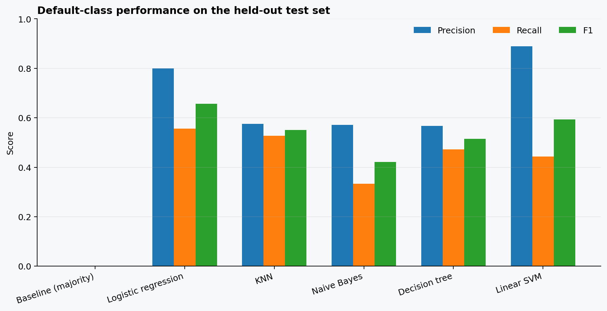
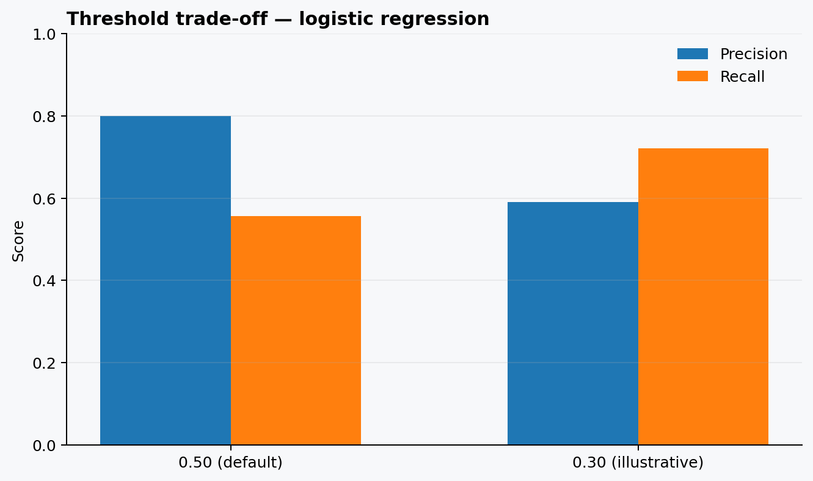
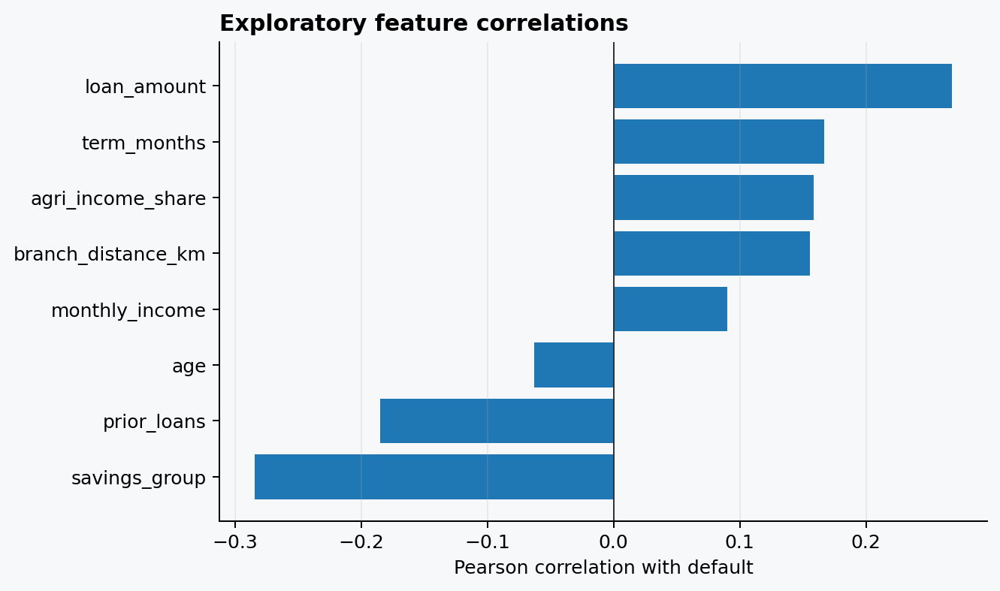
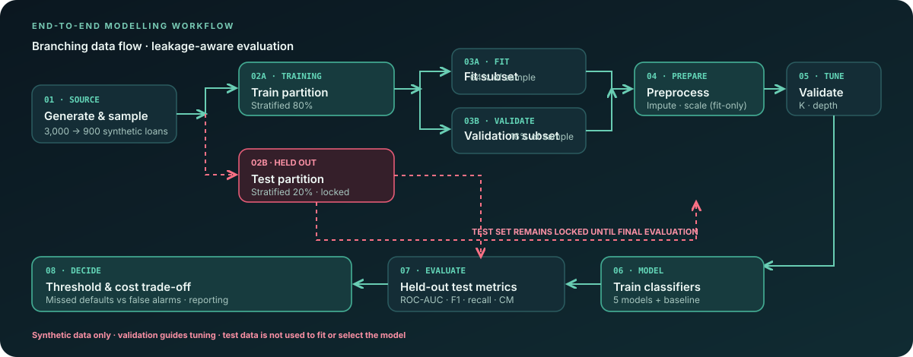
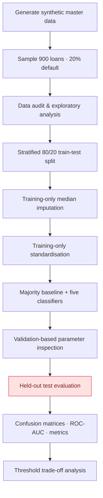

<div align="center">


### Wali Abidi · Machine Learning Portfolio

[](https://www.python.org/)
[](https://scikit-learn.org/)
[](#reproducibility)
[](#dataset--ethics)

**A reproducible binary-classification study of microloan repayment risk.**

[Explore the interactive project page](https://waliabidi2315.github.io/microloan-default-risk-analysis/) · [View source](https://github.com/WaliAbidi2315/microloan-default-risk-analysis)

</div>

---

## Executive summary

This project investigates whether borrower and loan attributes can help distinguish repaid microloans from loans that default. I built and evaluated five supervised classifiers against a majority-class baseline, using a stratified hold-out test set and preprocessing fitted exclusively on training data.

**Best overall ranking model:** Logistic Regression, with a test ROC-AUC of **0.888** and default-class F1 of **0.656**. At the default 0.5 threshold it identified 20 of 36 defaults (recall **55.6%**) while maintaining **80.0% precision**.

> **Scope note:** This is an educational modelling exercise on a deliberately simulated dataset. The synthetic risk formula determines the data-generating process, so these results demonstrate analytical workflow and model comparison—not validated lending performance or real-world borrower behaviour.

##  Highlights

-  **Leakage-aware preprocessing.** Median imputation and standardisation are fitted on the training partition only; the held-out test set is reserved for final evaluation.
-  **Five-model benchmark.** Logistic Regression, Linear SVM, KNN, Decision Tree and Gaussian Naive Bayes are compared with a majority-class baseline.
-  **Imbalance-aware evaluation.** Recall, precision, specificity, F1 and ROC-AUC are reported alongside accuracy, exposing the baseline's 0% default recall.
-  **Model behaviour investigated.** Validation sweeps examine KNN scaling and model complexity, while an information-gain calculation explains the decision tree's root split.
-  **Threshold trade-offs made visible.** A 0.50-to-0.30 threshold comparison shows the recall/precision trade-off and the increase in false alarms.
-  **Reproducible portfolio package.** Includes a walkthrough notebook, training scripts, evaluation figures, tests and an interactive project page.

## Results at a glance

| Test-set metric | Logistic Regression | Linear SVM | KNN | Decision Tree | Naive Bayes |
|---|---:|---:|---:|---:|---:|
| Accuracy | **0.883** | 0.878 | 0.828 | 0.822 | 0.817 |
| Precision | 0.800 | **0.889** | 0.576 | 0.567 | 0.571 |
| Recall | **0.556** | 0.444 | 0.528 | 0.472 | 0.333 |
| Specificity | 0.965 | **0.986** | 0.903 | 0.910 | 0.938 |
| F1 | **0.656** | 0.593 | 0.551 | 0.515 | 0.421 |
| ROC-AUC | **0.888** | 0.884 | 0.737 | 0.713 | 0.764 |

The majority-class baseline reaches **80.0% accuracy** by predicting every loan as repaid, but its default recall is **0.0%**. This is why accuracy alone is not a useful success criterion for this imbalanced classification problem.



## Key findings

### 01 · Logistic Regression was the strongest overall model

It achieved the highest ROC-AUC (**0.888**), F1 (**0.656**) and recall (**0.556**) on the held-out test set. Its confusion matrix was 139 true negatives, 5 false positives, 16 false negatives and 20 true positives.

### 02 · The operating threshold changes the business trade-off

Lowering the Logistic Regression threshold from 0.50 to 0.30 increased recall from **0.556 to 0.722** (20 to 26 defaults detected), while precision fell from **0.800 to 0.591**. False positives increased from 5 to 18. This illustrates why a threshold should reflect the relative cost of missed defaults and false alarms—and should be selected on validation data, not the final test set.



### 03 · Scaling materially helped KNN identify defaults

On the validation split, scaled KNN achieved **0.414 recall**, compared with **0.207** using unscaled features. The improvement is consistent with distance-based models being sensitive to feature units: large-valued monetary variables can otherwise dominate neighbour distances.

### 04 · Savings-group membership was the tree's first split

The decision tree's root split was `savings_group <= 0.5`. In the training data, the non-member branch had a **31.3%** default rate (111/355), compared with **9.0%** (33/365) for the member branch. This split reduced entropy from 0.7219 to a weighted 0.6639, an information gain of **0.0581**. These are patterns in the simulated data, not causal effects.



### 05 · Model complexity showed overfitting

For KNN, fit F1 was 1.000 at K=1 while validation F1 was 0.414; validation F1 peaked at K=3 (0.462). For the decision tree, fit F1 rose to 0.957 by depth 10 while validation F1 stayed in a much narrower band (roughly 0.32–0.42). The widening gap indicates overfitting as model complexity increases.

##  Pipeline

<p align="center">
  
</p>



The workflow keeps preprocessing statistics inside the training partition and uses validation data for model inspection. The test set is reserved for the final comparison.

## Dataset & ethics

- **Source:** generated in-project by `src/generate_data.py`; no external or personal borrower records.
- **Master population:** 3,000 simulated loan observations.
- **Analysis sample:** 900 rows, with 180 defaults and 720 repaid loans.
- **Target:** `default` — 1 means missed repayment within 12 months; 0 means repaid.
- **Features:** age, monthly household income, loan amount, term, prior loans, agricultural income share, branch distance and savings-group membership.
- **Missingness:** 24 monthly-income values and 14 branch-distance values are missing in the 900-row sample.
- **Class prevalence:** 20% defaults / 80% repaid.

The generator intentionally encodes a risk score using loan-to-income ratio, agricultural income share, branch distance, savings-group membership, prior loans, loan term and age. Consequently, feature associations and model performance partly reflect assumptions built into the simulation.

**Not suitable for lending decisions.** Real deployment would require representative real-world data, temporal and external validation, probability calibration, subgroup fairness analysis, cost-sensitive threshold selection, governance, monitoring and human oversight.

## Methods & implementation

| Area | Approach |
|---|---|
| Data splitting | Stratified 80/20 train/test split |
| Missing data | Median imputation, medians learned on training data only |
| Scaling | `StandardScaler`, fitted on training data only |
| Baseline | `DummyClassifier(strategy="most_frequent")` |
| Logistic Regression | `max_iter=1000`, scaled features |
| K-Nearest Neighbours | Assigned K=3, scaled features |
| Gaussian Naive Bayes | Median-imputed, unscaled features |
| Decision Tree | Entropy criterion, max depth=4 |
| Linear SVM | Linear kernel, C=1.0, scaled features |
| Evaluation | Accuracy, precision, recall, specificity, F1, ROC-AUC, confusion matrices |
| ROC-AUC | Computed from predicted probabilities or SVM decision scores—not hard class labels |

## Repository structure

```text
microloan-default-risk/
├── assets/
│   ├── cover.svg                 # Animated, hand-authored SVG cover
│   └── icons/                    # Hand-authored SVG icons
├── data/
│   └── synthetic_microloan_sample.csv
├── docs/
│   └── index.html                # Interactive GitHub Pages project page
├── notebooks/
│   └── project_walkthrough.ipynb
├── reports/
│   ├── figures/                  # Reproducible evaluation charts
│   ├── model_metrics.csv
│   ├── reproduced_model_metrics.csv
│   ├── threshold_analysis.csv
│   ├── knn_validation_sweep.csv
│   └── tree_depth_validation_sweep.csv
├── src/
│   ├── generate_data.py
│   └── train.py
├── tests/
│   └── test_pipeline.py
├── requirements.txt
└── README.md
```

## Run locally

```bash
git clone https://github.com/WaliAbidi2315/microloan-default-risk.git
cd microloan-default-risk

python -m venv .venv
# Windows
.venv\Scripts\activate
# macOS / Linux
source .venv/bin/activate

pip install -r requirements.txt

# Regenerate the fixed synthetic sample
python src/generate_data.py

# Refit the baseline and five classifiers
python src/train.py
```

The training script writes `reports/reproduced_model_metrics.csv`. The checked-in dataset and fixed split seed reproduce the reported test-set metrics.

## Reproducibility

- The synthetic master dataset uses a fixed random seed.
- The 900-row sample is generated with a fixed sample seed and exact class counts.
- The train/test split is stratified and deterministic.
- Imputation and scaling parameters are fitted only on the training partition.
- Hyperparameter inspection uses a validation subset from training data.
- The test set is held out for the final model comparison.

## Limitations & next steps

1. **Synthetic-to-real gap:** all records and outcome relationships are simulated.
2. **Small hold-out set:** only 36 defaults appear in the test set, so recall estimates are sensitive to a few observations.
3. **Single split:** repeated stratified cross-validation and confidence intervals would better quantify stability.
4. **No temporal validation:** the experiment does not test performance under changing borrower or economic conditions.
5. **No fairness or calibration study:** subgroup error rates and calibration have not been assessed.
6. **Threshold selection:** the 0.30 result is illustrative only; threshold selection must use validation data and an explicit cost framework.

A logical next iteration would add repeated cross-validation, calibration curves, cost-based threshold optimisation on validation folds, and a fairness audit—then repeat the process on a suitably governed real lending dataset.

## Author

**Wali Abidi**  
[GitHub](https://github.com/WaliAbidi2315)

---

<sub>Built as a machine-learning portfolio project. All data are synthetic. Metrics describe this experiment only and should not be interpreted as evidence of real-world lending effectiveness.</sub>
